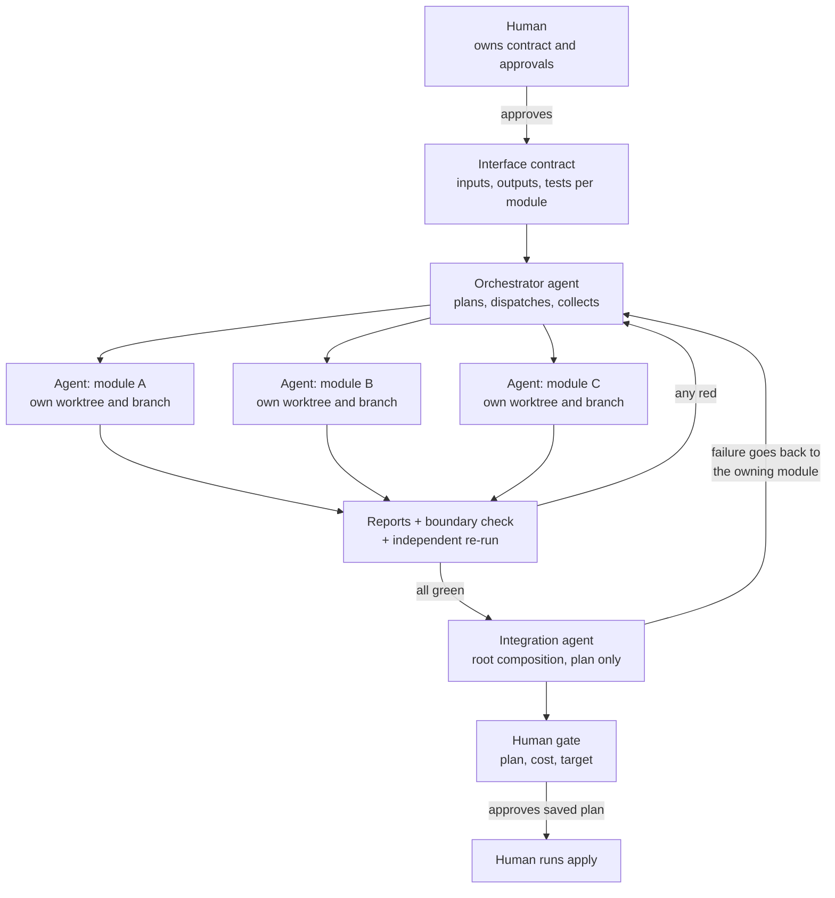

# Agentic IaC development: parallel module agents with human gates

How to use several AI coding agents to build independent Terraform modules in parallel, test each one inside a boundary, run one full integration after all of them finish, and stop for a human before any cost or real-environment change.

Prepared for Saravanan Gnanaguru • CloudEngine Labs • HUG Accra

**Two different topics, one word.** The Process Guide section 7 and README section 11 cover infrastructure *for* an agentic app (what a Session Planning Agent needs to run). This document covers agents *building* infrastructure. The agent here is a development tool, not part of the product.

**Execution boundary.** The base lab is Docker-only and its `CLAUDE.md` forbids cloud credentials. Everything in sections 1 to 8 below can run under those rules, using mock-provider tests and local `terraform plan`. Section 9 (real environments) is outside the base lab rules and needs a separately prepared, authorised sandbox. Follow Process Guide section 11 for that path rather than the shortcuts here.

## 1 When this pattern fits

Parallel agents pay off only when the work really splits.

| Fits | Does not fit |
|---|---|
| Modules whose only link is a typed input or output (a network name, a volume name, a port) | Modules that reference each other's resources directly |
| Each module can be tested alone with mocked inputs | A change that must land atomically across modules (a rename, a state move) |
| Different people could own the modules | One small module (one agent is enough) |
| Clear, reviewable interface before any code is written | Requirements still unclear. Agents will invent an interface and then disagree |

A module that needs another module's output is not independent. Either put it in a second wave that starts after the first wave is merged, or give it the output as a plain input variable and test it with a mocked value.

## 2 The shape



Roles:

| Role | Does | Must not |
|---|---|---|
| Human | Writes or approves the contract. Approves cost and every real apply. | Delegate apply to an agent |
| Orchestrator | Splits work, starts module agents, collects reports, re-runs checks, routes failures | Edit module code itself |
| Module agent (one per module) | Writes and tests one module inside its allowlist, reports | Touch other modules, shared files or its own control files |
| Integration agent | Composes modules in a root, runs validate, test and plan | Edit inside modules. A failure goes back to the module's owner |

Using one tool or several is fine. The orchestrator can be you, a lead agent in your AI coding tool, or a short script. What matters is that the boundaries and gates below are enforced by files, permissions and scripts, not only by prompt text.

## 3 Phase 0: write the contract first (human-approved)

**Why:** Tests must come from requirements, not from the code an agent just wrote (Process Guide section 10, step 1). A contract also stops two agents inventing incompatible interfaces.

One table per module. Example for a local Docker version of the Session Planning Agent infrastructure (illustrative):

| Module | Inputs | Outputs | Must be true (test requirements) |
|---|---|---|---|
| `network` | `name` (string) | `name` | Name must be non-empty |
| `static_site` | `network_name`, `host_port` (1024 to 65535), `site_path` | `container_name`, `url` | Port bound to `127.0.0.1` only. Site mounted read-only. Port below 1024 rejected. |
| `state_store` | `network_name`, `volume_name` | `volume_name`, `container_name` | No published host port. Data on a named volume. |

Also record, per module:

- The allowlist: `modules/<name>/` plus its report file
- Provider and Terraform version pins (owned by the orchestrator, not the module agents)
- Which test layers are required (section 6)
- What counts as done

Commit the contract before dispatching anything. The agents read it. They do not edit it.

## 4 Phase 1: isolate each agent

**Why:** Two agents in one working tree overwrite each other's files and cannot be audited separately. A worktree per agent gives each its own branch, files, `.terraform` directory and state.

Tool-agnostic setup with git:

```bash
git switch main && git pull --ff-only origin main
for m in network static_site state_store; do
  git worktree add -b "agent/$m" "../wt-$m" main
done
git worktree list
```

Each AI tool also has its own way to do this. The Claude Code row was checked against its docs on 20 November 2026. The Copilot and Codex rows come from search results and need checking against current vendor docs before you rely on them:

| Tool | Isolation | Role definition |
|---|---|---|
| Claude Code | `claude --worktree <name>` starts a session in its own worktree. A subagent file can set `isolation: worktree`. | `.claude/agents/<name>.md`, YAML frontmatter, `name` and `description` required |
| GitHub Copilot | Cloud agent works on its own branch. Check the docs for local worktree support. | `.github/agents/<name>.md`, YAML frontmatter, `name` and `description` |
| Codex | Worktrees are documented for the Codex desktop app, created under `$CODEX_HOME/worktrees` | `AGENTS.md`, merged from the project root down |

Copilot and Codex steps are not tested in this workshop, as with the rest of the Process Guide.

### Protect the control files

An agent that can edit `CLAUDE.md`, `.mcp.json` or its own agent definition can loosen its own rules. Treat these as protected and shared:

- `CLAUDE.md`, `AGENTS.md`, `.mcp.json`, `.claude/`, `.github/agents/`
- Root `versions.tf` or the provider pins, and `.terraform.lock.hcl`
- The contract and the root composition

The boundary check in section 5 fails on any change outside the allowlist, which covers all of these.

### Example module agent (Claude Code format)

`.claude/agents/module-network.md`, illustrative:

```markdown
---
name: module-network
description: Builds and tests only modules/network against the approved contract. Use for the network module.
tools: Read, Glob, Grep, Edit, Write, Bash, mcp__terraform__search_provider_docs, mcp__terraform__get_provider_details
model: inherit
isolation: worktree
---

You own modules/network/ and agent-reports/network.md. Nothing else.
Read docs/contract.md first. Write tests from the contract before the code.
Verify every provider argument with the Terraform MCP tools and name the
tools you called. Use mock_provider tests only. Never run apply or destroy.
Never use credentials. Stop and report if the contract is unclear.
Report each milestone using the format in docs/agentic-iac-development.md.
```

Notes:

- Only `name` and `description` are required. A misspelled field name is silently ignored, so copy field names exactly.
- `tools` limits which tools exist for the agent. It does not limit which paths it can write. Path control comes from the worktree plus the boundary check.
- The MCP tool names must match what `/mcp` shows in your session. Check them there.

### Deny the dangerous commands

In `.claude/settings.json`, illustrative:

```json
{
  "permissions": {
    "deny": [
      "Bash(terraform apply *)",
      "Bash(terraform destroy *)",
      "Bash(terraform import *)",
      "Bash(terraform state *)",
      "Bash(terraform force-unlock *)"
    ]
  }
}
```

Deny rules are evaluated before allow rules, and a trailing `*` also matches the bare command. They are a speed bump, not a sandbox. Claude Code's own docs say they do not stop every way of running a command (a different path to the binary, for example). The real controls are the ones that do not depend on the agent: no credentials in the environment, a mock or local-only provider, and a human who runs apply.

## 5 Phase 2: keep agents inside the boundary

**Why:** "Stay in your module" in a prompt is a request. A diff check is evidence.

Run this from each agent's worktree after it reports done, and again from the orchestrator. It checks committed, uncommitted and untracked files, and disables rename detection so a file moved out of another module cannot hide.

`scripts/check-boundary.sh`:

```bash
#!/usr/bin/env bash
# Usage: check-boundary.sh <module> [base-ref]
# Fails if the current tree touches anything outside the module's allowlist.
set -euo pipefail
module="${1:?module name}"
base="${2:-main}"
allow=("modules/${module}/" "agent-reports/${module}.md")

changed="$(
  {
    git diff --no-renames --name-only "${base}...HEAD"   # committed on the branch
    git diff --no-renames --name-only HEAD               # uncommitted edits
    git ls-files --others --exclude-standard             # new untracked files
  } | sort -u
)"

bad=0
while IFS= read -r f; do
  [ -z "$f" ] && continue
  ok=0
  for a in "${allow[@]}"; do
    case "$f" in "$a"*) ok=1 ;; esac
  done
  if [ "$ok" -eq 0 ]; then echo "OUT OF BOUNDS: $f"; bad=1; fi
done <<< "$changed"

[ "$bad" -eq 0 ] && echo "boundary ok: ${module}"
exit "$bad"
```

Rule: any `OUT OF BOUNDS` line rejects the branch. Do not hand-merge around it. Send it back to the agent with the list.

Also keep credentials out of the module phase. Module agents run with no cloud credentials, no `TF_VAR_*` secrets and no remote backend. Their tests use `mock_provider` or `command = plan` against a local provider.

## 6 Phase 3: test inside each module

**Why:** Each layer proves something different (Process Guide section 9). Require the cheap layers per module, and run the expensive ones once at integration.

| Layer | Per module | At integration | Notes |
|---|---|---|---|
| `terraform fmt -check`, `validate` | Yes | Yes | Catches invented arguments |
| Lint and static security scan | Yes | Yes | Review findings. Do not auto-apply every suggestion. |
| Mock-provider tests from the contract | Yes | No | Needs Terraform **1.7 or newer**. The base lab pins `>= 1.6.0`, so raise the minimum for this exercise. |
| Negative and boundary tests | Yes | No | Port below 1024 rejected, empty name rejected |
| Real-provider `plan` | No | Yes | Local Docker only in the base lab |
| Cross-module checks | No | Yes | Outputs from one feed inputs of another and still validate |
| Live apply and smoke tests | No | Only after human approval | Section 9 |

A module is done when every required layer has a recorded result and the reviewer can see what was mocked.

## 7 Phase 4: progress and test reporting

**Why:** With several agents running, silence looks the same as being stuck. A fixed format also makes reports comparable and checkable.

### Status states

Each agent writes one line per transition to `agent-reports/<module>.md`, newest at the bottom:

```text
queued -> contract-read -> tests-written -> code-written -> static-checks -> tests-run -> report-ready
                                   any state -> blocked (reason) | waiting-for-human (what)
```

The orchestrator prints a board whenever a state changes:

```text
module        state           last result                          updated
network       tests-run       validate ok, 4/4 mock tests pass     10:42
static_site   code-written    fmt fixed 1 file                     10:41
state_store   blocked         contract: volume name rule unclear   10:39
```

### Report template

`agent-reports/<module>.md`, written by the agent:

```markdown
# Report: <module>
Branch / commit: <name> @ <sha>
Terraform / provider versions: <from `terraform version`>
MCP tools called: <tool names, and which docs they returned>

## Checks
| Requirement (from contract) | Command | Result | Mocked? |
|---|---|---|---|
| Port bound to 127.0.0.1 | terraform test -filter=tests/contract.tftest.hcl | pass | yes, docker provider |

## Not tested
- <runtime health, image pull, real provider behaviour, ...>

## Assumptions and open questions
- <anything the contract did not settle>

## Needs a human
- <none, or the exact decision>
```

### Reports are claims, not evidence

The same model that wrote the code can misreport its own test run. Before accepting a module, the orchestrator or a script re-runs the checks on the branch and compares:

```bash
git -C ../wt-network diff --stat main...HEAD
scripts/check-boundary.sh network main          # from inside that worktree
terraform -chdir=modules/network fmt -check
terraform -chdir=modules/network init -backend=false
terraform -chdir=modules/network validate
terraform -chdir=modules/network test
```

If a report says pass and the re-run says fail, the report is wrong and the module goes back. Record both.

## 8 Phase 5: integration after all agents finish

**Why:** Independent modules can each pass and still fail together: a mismatched type, a duplicate name, a port clash.

1. **Wait for the gate.** Integration starts only when every module has a green re-run and a clean boundary check. One red module blocks it.
2. **Merge into an integration branch,** not main: `git switch -c integration/<name> main`, then merge each `agent/<module>` branch.
3. **Compose in a root module** owned by the integration agent. It wires outputs to inputs, owns the provider pins and the lock file, and contains no resources of its own beyond glue.
4. **Run the full sequence:** `init`, `fmt -check`, `validate`, all module tests, then `plan -out=integration.tfplan` against the local Docker provider.
5. **Read the plan for what it implies:** resource counts, replacements or deletions, published ports, mounts, anything known only after apply.
6. **Route failures back.** The integration agent must not patch inside `modules/`. It writes the failure against the owning module and the orchestrator re-opens that module's agent. If integration agents could edit modules, the boundaries would stop meaning anything.
7. **Re-run everything** after every fix. A fix in one module can break another.
8. **Write the integration report** in the same template, with the plan summary and what stays untested.

For a local Docker lab the integration stops at a reviewed plan. Apply is a human decision (next section).

## 9 Human gates: cost and real environments

**Why:** Prompt instructions are not a control. Approvals have to be steps that agents cannot perform.

| Gate | Human decides | Agents may not |
|---|---|---|
| G0 Contract | Interfaces, tests and allowlists are right | Start before approval |
| G1 Fan-out cost | How many agents, retry limits, model, time limit. Parallel agents multiply model usage, so this is a cost decision too. | Spawn extra agents or loop past the limit |
| G2 Integration review | Reads the reports, the re-run results and the plan | Merge to main |
| G3 Infrastructure cost | Reviews the estimate for the exact plan (a cost tool such as Infracost, or the cloud pricing calculator) | Create billable resources |
| G4 Real environment apply | Approves one saved plan for one named target | Run apply, destroy or import. Hold apply credentials. |

### Approval request

When an agent reaches a gate it stops with a message in this shape. It does not wait in a loop or retry.

```text
WAITING FOR HUMAN APPROVAL: G4
Target:        <account / project / local engine>, <region>
Plan file:     integration.tfplan  sha256:<hash>
Changes:       <N> create, <N> update, <N> replace, <N> destroy
Estimated cost: <figure and source, or "not estimated">
Not tested:    <list>
Teardown:      <how and when the test environment is removed>
Expires:       approval is void if the plan, target or inputs change
```

Rules that keep the gate real:

- **Approval is tied to the plan.** Record the plan file hash. If the plan is regenerated or the inputs change, the old approval is void.
- **One execution owner.** A human or one pipeline runs apply. An agent and a pipeline never both apply the same state.
- **Credentials follow the stage.** Module phase: none. Integration plan: read-only or plan-only role if a real provider is used. Apply role: held by the human or the pipeline, never by the agent.
- **Stop conditions.** The agent stops and asks on account mismatch, unexpected spend, data-loss risk, a policy failure, or a plan that differs from the approved one.
- **Real cloud follows the Process Guide.** Use its Gates 1 to 9 and the prompt in section 13. Do not shortcut them because several agents produced the code.

## 10 Common mistakes

| Mistake | Effect | Fix |
|---|---|---|
| Agents share one working tree | Overwritten files, no audit trail | One worktree and branch each |
| Boundary only in the prompt | Silent edits to shared files | Diff check against an allowlist |
| Contract written after the code | Tests restate the implementation | Contract first, human-approved |
| Trusting worker reports | Wrong "pass" accepted | Re-run on the branch |
| Integration agent edits modules | Ownership lost | Failures routed to owning module |
| Providers pinned differently per module | Integration surprises | Pins owned by the root |
| Mock passes read as "it works" | Real provider behaviour untested | Report mocked vs real in every report |
| No fan-out cap | Surprise model cost | Set agent and retry limits at G1 |

## 11 Checklist

- [ ] Modules are independent, or the dependent ones are in a later wave
- [ ] Contract committed and approved before dispatch (G0)
- [ ] Agent count and retry limits approved (G1)
- [ ] One worktree and branch per agent, shared and control files protected
- [ ] No credentials in the module phase
- [ ] `check-boundary.sh` passes for every module
- [ ] Reports use the template and list what was mocked and what was not tested
- [ ] Orchestrator re-ran fmt, validate and tests and the results match
- [ ] Integration ran on an integration branch, failures routed to owners
- [ ] Plan reviewed and cost estimated before any real apply (G2, G3)
- [ ] Apply run by a human on the approved saved plan (G4)

## Verification status

Checked on 20 November 2026: the Claude Code subagent frontmatter, `isolation: worktree`, `claude --worktree <name>` and the deny-rule syntax against Claude Code documentation pages; the existence of `.github/agents/` Copilot custom agents and Codex worktrees through search results, with Codex worktrees documented for the desktop app only. The boundary script was run in a throwaway git repository and correctly passed a clean branch and rejected edits to a shared file, to another module and to a file moved out of another module.

Not executed: the subagent file, the settings snippet, the full orchestration with real agents, the mock-provider tests (Terraform 1.7 or newer), integration against the lab's Docker provider, and any cost estimate or cloud step. The module names and the contract table are illustrative. Run a rehearsal with two small modules before presenting this as tested.

## References

- Claude Code subagents: https://code.claude.com/docs/en/sub-agents
- Claude Code permissions: https://code.claude.com/docs/en/permissions
- Claude Code worktrees: https://code.claude.com/docs/en/common-workflows
- GitHub Copilot custom agents: https://docs.github.com/en/copilot/concepts/agents/cloud-agent/about-custom-agents
- Terraform tests and mocking: https://developer.hashicorp.com/terraform/language/tests/mocking
- In this repo: `docs/Terraform_MCP_Process_Guide.md` sections 8 to 11 and 13
