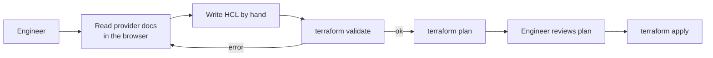
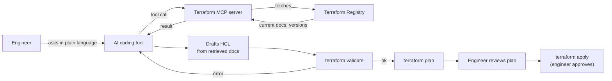
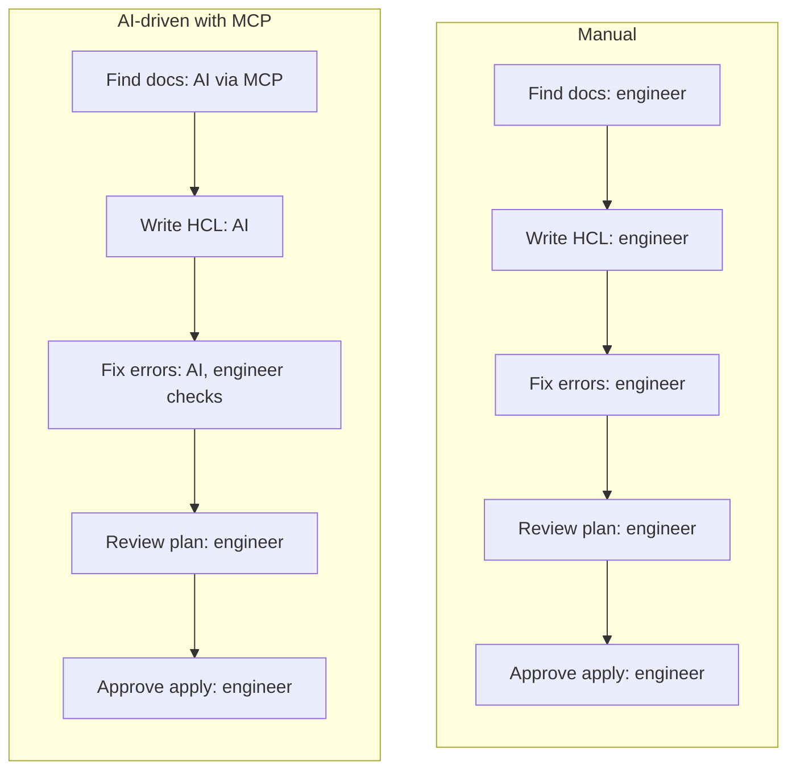
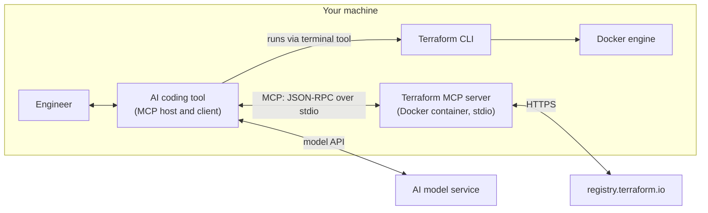

# Session intro: manual vs AI-driven IaC, and where MCP fits

Diagrams use Mermaid, which GitHub renders. Presenter notes are under each diagram.

## 1. The problem

Learning a new provider means reading many documentation pages, then writing and fixing HCL by hand. An AI assistant can write HCL for you, but on its own it answers from training data, which can be outdated or wrong for a specific provider version.

An MCP server closes that gap. It is a backend layer the AI tool calls to fetch current, authoritative answers instead of guessing.

## 2. Diagram A: manual IaC development

- Every lookup is done by the engineer.
- You learn the provider by reading, which is the strength of this path.
- Fixing a validation error usually sends you back to the docs.

## 3. Diagram B: AI-driven IaC development with MCP

- The lookup step moves from the engineer to the AI plus MCP.
- Validation, plan review and apply approval stay with the engineer.
- The AI must name the MCP tools it actually called, so you can tell a real lookup from an answer given from memory.

## 4. Side by side: who does each step

The last two steps do not move. That is the point of the session: the AI speeds up research and drafting, and the engineer keeps the decisions.

This comparison is qualitative. No timings are claimed. If you want numbers, run both paths yourself and record them.

## 5. Architecture: what MCP is

Roles in this lab:

| Piece | Job |
|---|---|
| AI coding tool | Reads requirements, edits files, calls MCP tools, runs terminal commands |
| Terraform MCP server | Looks up provider docs, modules and policies from the registry |
| Terraform CLI | Validates, plans and applies. MCP does not run it in this lab. |
| Docker | Runs the lab resources |

MCP is a development-time helper. It is not a runtime dependency of the application being built.

## 6. What the registry toolset exposes

This lab starts the server with `--toolsets=registry`. The tools below were visible in the connected server on 2026-11-19:

| Purpose | Tools |
|---|---|
| Provider docs | `get_latest_provider_version`, `get_provider_capabilities`, `search_provider_docs`, `get_provider_details` |
| Modules | `get_latest_module_version`, `search_modules`, `get_module_details` |
| Policies | `search_policies`, `get_policy_details` |

Workspace, run and variable tools exist in the full server, but they need an HCP Terraform or Terraform Enterprise token and can change things. They are not enabled here.

Example lookup chain from the server's own instructions: `get_latest_provider_version` then `get_provider_capabilities` then `search_provider_docs` then `get_provider_details`.

## 7. Choosing a deployment option

Source: HashiCorp's Terraform MCP server deploy pages, read on 2026-11-19. Check them again before the event, because the remote server is in beta.

| | Local (this lab) | Self-hosted | Remote |
|---|---|---|---|
| Who runs it | You, on your machine | You, in an environment you manage, for example ECS on Fargate | HashiCorp |
| Transport | stdio, or streamable-http | streamable-http | streamable-http |
| Install | Docker, binary or source | Docker, binary or source | None |
| Best for | Getting started, one-off projects | Central management by a team | HCP Terraform without running a server |
| Terraform Enterprise | Supported | Supported | Not supported |
| Token needed | Not for registry lookups | Only for HCP Terraform or Terraform Enterprise features | HCP Terraform API token on every request |
| Status on the deploy page | Not marked beta | Not marked beta | Beta |

Notes for the presenter:

- The lab runs the Docker image on the laptop over stdio. HashiCorp calls that **Local**. The lab README calls it "self-hosted", but under HashiCorp's definitions self-hosted means a server you operate for others over streamable-http.
- Remote has no install, but it supports US HCP Terraform organisations only, it is rate limited, and the page discourages beta features in production.
- Self-hosted over HTTP needs TLS and authentication in front of it if it is not bound to localhost.

## 8. Does it work offline?

No, for the part that matters. The Docker image holds the server program, not the documentation. Lookups are live calls to the public registry.

- Pulling the image needs internet once. After that the container starts without it.
- Registry lookups fail without network access.
- The AI tool also needs to reach its model service.
- Static snapshots of fetched docs can be saved and used offline, but they can go stale.

## 9. Version note from rehearsal prep

Checked through the MCP server on 2026-11-19:

- `kreuzwerker/docker` latest version: **4.7.0**.
- Version **4.6.0**, the version this lab pins, is available and its `docker_container` resource documentation can be retrieved.

The lab pins 4.6.0 on purpose for repeatability. It is not the latest.
