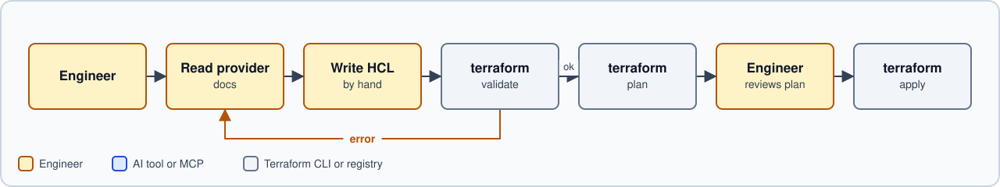
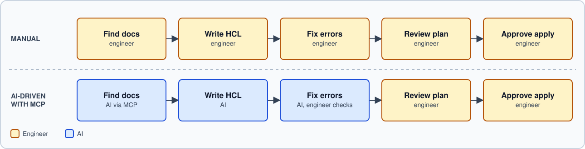

# Agentic Infrastructure coding for Building IaC with the Terraform MCP Server

**Presenter**: Saravanan Gnanaguru, CloudEngine Labs

**Event**: HUG Accra Session, 21 November 2026 - 1:00 PM GMT - 6:30 PM IST.


*The session in one picture: one agent goes from the application brief to an approved architecture, then writes Terraform while checking provider docs through the Terraform MCP server, and stops at a dry-run plan. With several agents, an approved contract fans out to module agents, their reports are re-checked, and one integration plan reaches the same human gate. A human approves the architecture and decides on cost and any real apply.*

---

## The Session Agenda

1. Compare manual and AI-driven IaC development
2. See what an MCP server is and where it sits
3. Set up the Terraform MCP server
4. Use it: look up docs, review Terraform, validate, plan
5. Scale up: several agents building independent modules, with human approval gates

**Say:** Everything runs on a laptop with Docker. No cloud account is needed. You need internet and access to one AI coding tool.

---

## The Problem

- Learning a provider means reading many doc pages
- Then write HCL, hit an error, go back to the docs
- AI can write HCL, but from memory it can be outdated or wrong for your provider version

**Say:** Ask who has copied an argument from an old blog post that no longer exists.

---

## Manual IaC development



- Every lookup is yours
- You learn the provider by reading. That is the strength of this path.

---

## AI-driven IaC development with MCP


**Say:** The lookup moved. The review and the approval did not.

---

## Who does each step



- AI speeds up research and drafting
- The engineer keeps the decisions
- This is a qualitative comparison. No timings are claimed.

**Say:** Manual still wins for learning. Use it when you want to understand a provider, not just ship.

---

## What is MCP

- MCP is the Model Context Protocol: a standard way for AI tools to call external servers
- The server exposes tools. The AI tool discovers them and calls them.
- It is a backend layer, so any MCP-capable AI tool can use the same server
- The Terraform MCP server gives AI models real-time access to provider docs, modules and policies from the public Terraform registry

**Say:** Think of it as an API for the AI tool, so the answer comes from the source instead of from memory.

---

## Architecture


| Piece | Job |
|---|---|
| AI coding tool | Reads requirements, edits files, calls MCP tools, runs terminal commands |
| Terraform MCP server | Looks up provider docs, modules and policies |
| Terraform CLI | Validates, plans, applies. MCP does not run it here. |
| Docker | Runs the lab resources |

**Say:** MCP helps while we develop. It is not part of the running application.

---

## What the server can do

Start it with `--toolsets=registry`, so only read-only registry lookups are enabled.

| Purpose | Tools |
|---|---|
| Provider docs | `get_latest_provider_version`, `get_provider_capabilities`, `search_provider_docs`, `get_provider_details` |
| Modules | `get_latest_module_version`, `search_modules`, `get_module_details` |
| Policies | `search_policies`, `get_policy_details` |

The full server also has workspace, run and variable tools for HCP Terraform and Terraform Enterprise. They need a token and can change things. We do not enable them.

**Say:** Least privilege applies to AI tools too. The lab needs documentation only, so that is all it gets.

---

## Three ways to run it

| | Who runs it | Good for |
|---|---|---|
| **Laptop, in Docker (this lab)** | You, on your machine | Getting started. |
| Shared server | Your team, in an environment you manage | Central management by a team |
| Remote | HashiCorp | HCP Terraform without running a server. Beta. |

Today we use the first one.

**Say:** Today we run it ourselves, in Docker on the laptop. HashiCorp's docs call that setup Local, and reserve the name Self-hosted for a shared server a team operates over HTTP. Same container image either way.

If asked for detail (all from HashiCorp's deploy page, so recheck it before presenting):
- Transport: stdio or streamable-http for the laptop setup, streamable-http for the shared server and Remote. Install: Docker, binary or source for the first two, none for Remote.
- Terraform Enterprise (the on-prem hosted version): the laptop and shared setups can connect to it. Remote cannot.
- Remote at `https://mcp.terraform.io/mcp` supports US HCP Terraform organisations only and is rate limited. It is the one marked beta.
- The other two are not marked beta on the deploy page. That is not the same as generally available.
- A shared server exposed beyond localhost needs TLS and authentication in front of it.

---

## Does it work offline?

- No, not for lookups. The Docker image holds the server, not the docs.
- Image pull needs internet once. Lookups are live calls to the registry.
- The AI tool also needs to reach its model service.
- Saved snapshots of docs work offline but can go stale.

---

## Setup: prerequisites

```bash
brew tap hashicorp/tap
brew install hashicorp/tap/terraform
terraform version
docker version
docker info
```

- Docker must report a working server, not only a client
- Confirm Docker points at a local socket:

```bash
docker context inspect --format '{{.Endpoints.docker.Host}}'
export DOCKER_HOST="$(docker context inspect --format '{{.Endpoints.docker.Host}}')"
docker pull hashicorp/terraform-mcp-server:1.4.1
```

**Say:** Launch your AI tool from this same terminal so it inherits the Docker endpoint.

---

## Setup: connect the MCP server

```bash
claude mcp add --transport stdio --scope project terraform -- \
  docker run -i --rm \
  hashicorp/terraform-mcp-server:1.4.1 \
  stdio --toolsets=registry
claude mcp list
claude
```

Then, inside Claude Code:

```text
/mcp
```

Check that `terraform` is connected and its registry tools are listed.

- `stdio`: the AI tool launches the container directly, so no network port is opened
- Pinned image tag: no surprise upgrade mid-session
- No Docker socket mounted into the MCP container
- `--scope project`: the config is saved in `.mcp.json` in this folder

**Say:** We demo Claude Code. The same server works with any MCP-capable AI tool, each with its own registration steps. GitHub Copilot and Codex steps are in the Process Guide in `docs/`, and are untested.

---

## Hands-on 1: prove a real lookup

Paste into the AI tool:

```text
Read CLAUDE.md. Discover the connected Terraform MCP tools. Use the public
registry tools to find the kreuzwerker/docker provider documentation for
version 4.6.0 and its docker_image, docker_network and docker_container
resources. Verify image_id, ports.ip, networks_advanced and read-only host
volume mounts. Show which tools you actually called and the documentation
identifiers or URLs returned. If version-specific retrieval is unavailable,
say so. Do not edit files or run Terraform yet.
```

- Look for real tool calls in the conversation
- A confident answer with no tool call is not proof

**Say:** Checked before this session: `kreuzwerker/docker` 4.6.0 is available and its container docs can be retrieved. The latest version is 4.7.0. We pin 4.6.0 for repeatability.

---

## Hands-on 2: review the Terraform

Open `infra/main.tf` and walk through it:

- Provider pinned to `4.6.0`, Terraform `>= 1.6.0, < 2.0.0`
- Image `nginx:1.28-alpine`, kept locally
- Dedicated network `meeting-pulse-lab`
- Port bound to `127.0.0.1` only
- `site/` mounted read-only into the container
- `host_port` variable validated to 1024 to 65535

Prompt:

```text
Using the Terraform documentation you retrieved, review infra/main.tf.
Explain every resource, dependencies, local Docker endpoint, bind mount,
provider pin and localhost port binding. Compare the implementation with
CLAUDE.md. Make only corrections needed for valid provider syntax. Do not
apply. Keep this a static web infrastructure foundation, not a full app.
```

---

## Hands-on 3: validate

```bash
terraform -chdir=infra init
terraform -chdir=infra fmt
terraform -chdir=infra validate
terraform -chdir=infra fmt -check
```

- `init` downloads the pinned provider and writes the lock file. Keep the lock file.
- `validate` catches invented arguments. It does not prove the plan or the runtime.

---

## Hands-on 4: plan, then stop

```bash
terraform -chdir=infra plan -out=demo.tfplan
terraform -chdir=infra show -no-color demo.tfplan
terraform -chdir=infra show -json demo.tfplan > infra/plan.json
```

- Expected on fresh state: three creations (image, network, container). Read the real output.
- The plan does not prove the image will pull or the page will be healthy.

```text
Read infra/plan.json. Explain each proposed resource action, the localhost
exposure and host mount. Identify values known only after apply and any
replacements or deletions. Separate what this plan verifies from runtime
health and image-pull success, which have not been tested. Stop for review.
```

**Say:** You can stop here. MCP lookup, AI-assisted code, validation and a real plan are done without changing a running resource.

---

## Optional: apply, change, clean up

```bash
terraform -chdir=infra apply demo.tfplan
curl --fail http://127.0.0.1:8080/health.json
terraform -chdir=infra plan -detailed-exitcode     # 0 means no changes
```

Change the port, review the plan, apply:

```bash
printf 'host_port = 8081\n' > infra/terraform.tfvars
terraform -chdir=infra plan -out=change.tfplan
```

Clean up:

```bash
terraform -chdir=infra plan -destroy -out=cleanup.tfplan
terraform -chdir=infra apply cleanup.tfplan
```

- Applying a saved plan has no yes/no prompt. Running it is your approval, so you run it, not the agent.
- Never use `docker system prune` as cleanup.

---

## Guardrails we used

- Registry toolset only: no tokens, no cloud credentials
- No Docker socket in the MCP container
- Ports bound to `127.0.0.1`
- The agent may edit, init, fmt, validate and plan. It asks before apply, destroy or stopping containers.
- Evidence over claims: name the tools called, report failed checks

---

## Scale up: agents building infrastructure

This section is about agents *building* infrastructure. It is not about the infrastructure an AI app needs to run.

- One agent per independent module, working in parallel
- Each agent tests its own module inside a boundary
- One full integration run after every agent has finished
- Agents report progress and test results
- A human approves any cost and any real-environment deployment

Fits when modules only meet through typed inputs and outputs. Does not fit when modules reference each other's resources or must change atomically.

**Say:** Full write-up: `docs/agentic-iac-development.md`. This is a pattern to try after today. The lab does not run it, and the steps in that document have not been run end to end.

---

## The shape


**Say:** Two things the agents never do: change the contract, and run apply.

---

## Boundaries that are not just a prompt

| Control | What it stops |
|---|---|
| Contract written and approved first | Agents inventing incompatible interfaces. Tests come from requirements, not from the generated code. |
| One git worktree and branch per agent | Agents overwriting each other. Gives each its own audit trail. |
| Allowlist: `modules/<name>/` plus its report | Edits to other modules and shared files |
| Protected files: `CLAUDE.md`, `.mcp.json`, `.claude/`, provider pins, lock file | An agent loosening its own rules |
| No credentials during the module phase | Real changes from a development step |
| Deny rules for apply, destroy, import, state | Accidental commands. A speed bump, not a sandbox. |

**Say:** "Stay in your module" in a prompt is a request. A diff check is evidence.

---

## Check the boundary

```bash
git worktree add -b agent/network ../wt-network main
# agent works, then from inside the worktree:
scripts/check-boundary.sh network main
```

- Compares the branch, uncommitted edits and untracked files against the module allowlist
- Rename detection is off, so a file moved out of another module cannot hide
- Any `OUT OF BOUNDS` line rejects the branch

**Say:** The script is in the doc. We ran it in a throwaway repo: a clean branch passes, and edits to a shared file, to another module and to a moved file are caught. The agent setup around it has not been run.

---

## Test each module on its own

| Layer | Per module | At integration |
|---|---|---|
| `fmt -check`, `validate` | Yes | Yes |
| Lint and static security scan | Yes | Yes |
| Mock-provider tests from the contract | Yes | No |
| Negative and boundary tests | Yes | No |
| Real-provider `plan` | No | Yes |
| Cross-module checks | No | Yes |
| Apply and smoke tests | No | Only after human approval |

- Mock tests need Terraform 1.7 or newer. The lab pins `>= 1.6.0`, so raise it for this exercise.
- A mock pass does not prove the real provider behaves the same way.

---

## Progress and test reports

```text
module        state           last result                          updated
network       tests-run       validate ok, 4/4 mock tests pass     10:42
static_site   code-written    fmt fixed 1 file                     10:41
state_store   blocked         contract: volume name rule unclear   10:39
```

Each report lists: commit, tool versions, MCP tools called, requirement, command, result, what was mocked, what was not tested, open questions, and what needs a human.

- Reports are claims, not evidence. The orchestrator re-runs fmt, validate and tests on the branch and compares.
- A mismatch sends the module back.

**Say:** Silence from an agent looks the same as being stuck. A fixed format makes reports comparable and checkable.

---

## Integration after all agents finish

1. Start only when every module has a green re-run and a clean boundary check
2. Merge into an integration branch, not main
3. Compose in a root module that owns the provider pins and lock file
4. `init`, `fmt -check`, `validate`, all module tests, then `plan -out`
5. Read the plan: replacements, deletions, ports, mounts
6. A failure goes back to the module's owner. The integration agent does not patch inside modules.
7. Re-run everything after each fix

**Say:** Independent modules can each pass and still fail together: a type mismatch, a duplicate name, a port clash.

---

## Human gates for cost and real environments

| Gate | Human decides |
|---|---|
| G0 Contract | Interfaces, tests and allowlists |
| G1 Fan-out cost | Number of agents, retry limits, model. Parallel agents multiply usage. |
| G2 Integration review | Reports, re-run results and the plan |
| G3 Infrastructure cost | Estimate for the exact plan |
| G4 Real apply | One saved plan, one named target |

- The agent stops with: target, plan file hash, changes, estimated cost, not tested, teardown
- Approval is tied to the plan hash. A changed plan or input voids it.
- A human or one pipeline runs apply. The agent holds no apply credentials.
- Real cloud is outside this lab's rules. Use Process Guide section 11.

**Say:** Same rule as "Optional: apply, change, clean up", now with more agents: running the apply is the approval, so you run it.

---

## Takeaways

1. MCP is a backend layer that gives AI tools current, authoritative answers
2. Lookup and drafting move to the AI. Review and approval stay with you.
3. Ask the AI to show its tool calls
4. Give it only the tools it needs
5. Plan before apply, every time
6. With many agents: contract first, one boundary each, independent re-checks, one integration, human gates

---

## Where to go next

- Terraform MCP server docs: https://developer.hashicorp.com/terraform/mcp-server
- Deployment options: https://developer.hashicorp.com/terraform/mcp-server/deploy
- Tool reference: https://developer.hashicorp.com/terraform/mcp-server/reference
- Source: https://github.com/hashicorp/terraform-mcp-server
- Docker provider: https://registry.terraform.io/providers/kreuzwerker/docker/4.6.0/docs
- In this repo: `README.md` for the full lab, `docs/session-intro.md` for the diagram notes, `docs/Terraform_MCP_Process_Guide.md` for the full process guide, `docs/agentic-iac-development.md` for multi-agent module development
