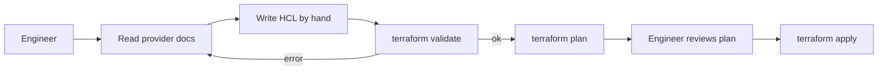
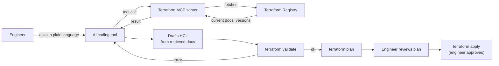
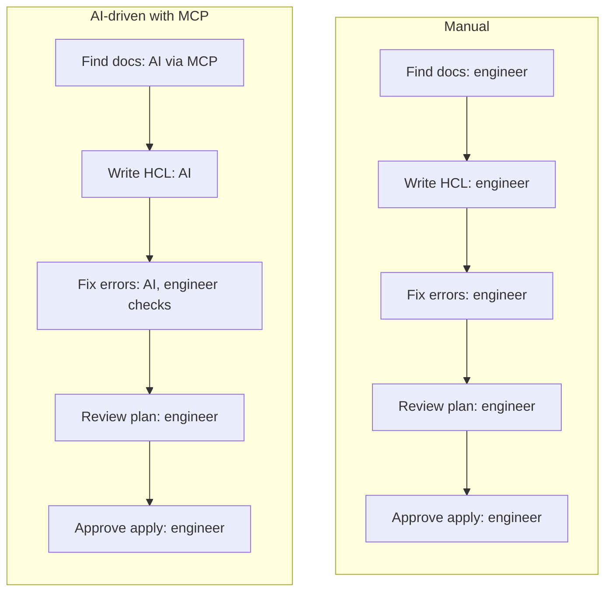
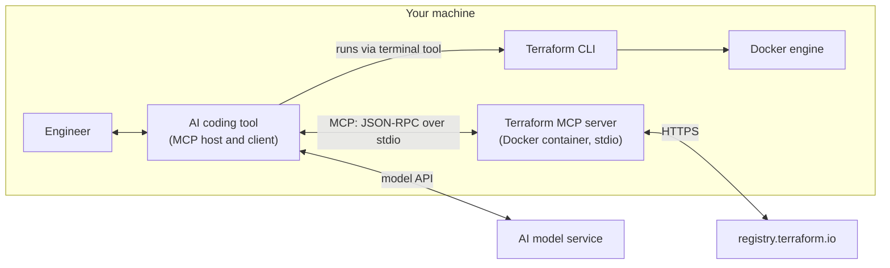

# Terraform MCP: AI-assisted IaC without leaving the docs behind

Session slides for walking through live. Each slide is a section between `---` lines. Lines starting with **Say:** are presenter notes. Trim any slide you do not need.

Prepared for Saravanan Gnanaguru, CloudEngine Labs, HUG Accra, 19 November 2026.

---

## Slide 1: What we will do today

1. Compare manual and AI-driven IaC development
2. See what an MCP server is and where it sits
3. Set up the Terraform MCP server
4. Use it: look up docs, review Terraform, validate, plan
5. Talk about infrastructure for an agentic app

**Say:** Everything runs on a laptop with Docker. No cloud account is needed. You need internet and access to one AI coding tool.

---

## Slide 2: The problem

- Learning a provider means reading many doc pages
- Then write HCL, hit an error, go back to the docs
- AI can write HCL, but from memory it can be outdated or wrong for your provider version

**Say:** Ask who has copied an argument from an old blog post that no longer exists.

---

## Slide 3: Manual IaC development



- Every lookup is yours
- You learn the provider by reading. That is the strength of this path.

---

## Slide 4: AI-driven IaC development with MCP



**Say:** The lookup moved. The review and the approval did not.

---

## Slide 5: Who does each step



- AI speeds up research and drafting
- The engineer keeps the decisions
- This is a qualitative comparison. No timings are claimed.

**Say:** Manual still wins for learning. Use it when you want to understand a provider, not just ship.

---

## Slide 6: What is MCP

- MCP is the Model Context Protocol: a standard way for AI tools to call external servers
- The server exposes tools. The AI tool discovers them and calls them.
- It is a backend layer, so any MCP-capable AI tool can use the same server
- The Terraform MCP server gives AI models real-time access to provider docs, modules and policies from the public Terraform registry

**Say:** Think of it as an API for the AI tool, so the answer comes from the source instead of from memory.

---

## Slide 7: Architecture



| Piece | Job |
|---|---|
| AI coding tool | Reads requirements, edits files, calls MCP tools, runs terminal commands |
| Terraform MCP server | Looks up provider docs, modules and policies |
| Terraform CLI | Validates, plans, applies. MCP does not run it here. |
| Docker | Runs the lab resources |

**Say:** MCP helps while we develop. It is not part of the running application.

---

## Slide 8: What the server can do

We start it with `--toolsets=registry`, so only read-only registry lookups are enabled.

| Purpose | Tools |
|---|---|
| Provider docs | `get_latest_provider_version`, `get_provider_capabilities`, `search_provider_docs`, `get_provider_details` |
| Modules | `get_latest_module_version`, `search_modules`, `get_module_details` |
| Policies | `search_policies`, `get_policy_details` |

The full server also has workspace, run and variable tools for HCP Terraform and Terraform Enterprise. They need a token and can change things. We do not enable them.

**Say:** Least privilege applies to AI tools too. The lab needs documentation only, so that is all it gets.

---

## Slide 9: Three ways to run it

| | Self-hosted on your laptop (this lab) | Self-hosted shared server | Remote |
|---|---|---|---|
| HashiCorp's name | Local | Self-hosted | Remote |
| Who runs it | You, on your machine | You, in an environment you manage | HashiCorp |
| Transport | stdio, or streamable-http | streamable-http | streamable-http |
| Install | Docker, binary or source | Docker, binary or source | None |
| Best for | Getting started | Central management by a team | HCP Terraform without running a server |
| Terraform Enterprise | Supported | Supported | Not supported |
| Token | Not for registry lookups | Only for HCP or TFE features | HCP Terraform token on every request |
| Status | Not marked beta | Not marked beta | Beta |

- Remote at `https://mcp.terraform.io/mcp` supports US HCP Terraform organisations only and is rate limited
- A self-hosted server exposed beyond localhost needs TLS and authentication in front of it

**Say:** Today we self-host it ourselves, in Docker on the laptop. HashiCorp's docs call that setup Local, and reserve the name Self-hosted for a shared server a team operates over HTTP. Same container image either way. Check their deploy pages before presenting, because the remote server is in beta.

---

## Slide 10: Does it work offline?

- No, not for lookups. The Docker image holds the server, not the docs.
- Image pull needs internet once. Lookups are live calls to the registry.
- The AI tool also needs to reach its model service.
- Saved snapshots of docs work offline but can go stale.

---

## Slide 11: Setup: prerequisites

```bash
brew tap hashicorp/tap
brew install hashicorp/tap/terraform
terraform version
docker version
docker info
```

- Docker must report a working server, not only a client
- Confirm Docker points at a local socket:

```bash
docker context inspect --format '{{.Endpoints.docker.Host}}'
export DOCKER_HOST="$(docker context inspect --format '{{.Endpoints.docker.Host}}')"
docker pull hashicorp/terraform-mcp-server:1.4.1
```

**Say:** Launch your AI tool from this same terminal so it inherits the Docker endpoint.

---

## Slide 12: Setup: connect the MCP server

```bash
claude mcp add --transport stdio --scope project terraform -- \
  docker run -i --rm \
  hashicorp/terraform-mcp-server:1.4.1 \
  stdio --toolsets=registry
claude mcp list
claude
```

Then, inside Claude Code:

```text
/mcp
```

Check that `terraform` is connected and its registry tools are listed.

- `stdio`: the AI tool launches the container directly, so no network port is opened
- Pinned image tag: no surprise upgrade mid-session
- No Docker socket mounted into the MCP container
- `--scope project`: the config is saved in `.mcp.json` in this folder

**Say:** We demo Claude Code. The same server works with any MCP-capable AI tool, each with its own registration steps. GitHub Copilot and Codex steps are in the Process Guide in `docs/`, and are untested.

---

## Slide 13: Hands-on 1: prove a real lookup

Paste into the AI tool:

```text
Read CLAUDE.md. Discover the connected Terraform MCP tools. Use the public
registry tools to find the kreuzwerker/docker provider documentation for
version 4.6.0 and its docker_image, docker_network and docker_container
resources. Verify image_id, ports.ip, networks_advanced and read-only host
volume mounts. Show which tools you actually called and the documentation
identifiers or URLs returned. If version-specific retrieval is unavailable,
say so. Do not edit files or run Terraform yet.
```

- Look for real tool calls in the conversation
- A confident answer with no tool call is not proof

**Say:** Checked before this session: `kreuzwerker/docker` 4.6.0 is available and its container docs can be retrieved. The latest version is 4.7.0. We pin 4.6.0 for repeatability.

---

## Slide 14: Hands-on 2: review the Terraform

Open `infra/main.tf` and walk through it:

- Provider pinned to `4.6.0`, Terraform `>= 1.6.0, < 2.0.0`
- Image `nginx:1.28-alpine`, kept locally
- Dedicated network `meeting-pulse-lab`
- Port bound to `127.0.0.1` only
- `site/` mounted read-only into the container
- `host_port` variable validated to 1024 to 65535

Prompt:

```text
Using the Terraform documentation you retrieved, review infra/main.tf.
Explain every resource, dependencies, local Docker endpoint, bind mount,
provider pin and localhost port binding. Compare the implementation with
CLAUDE.md. Make only corrections needed for valid provider syntax. Do not
apply. Keep this a static web infrastructure foundation, not a full app.
```

---

## Slide 15: Hands-on 3: validate

```bash
terraform -chdir=infra init
terraform -chdir=infra fmt
terraform -chdir=infra validate
terraform -chdir=infra fmt -check
```

- `init` downloads the pinned provider and writes the lock file. Keep the lock file.
- `validate` catches invented arguments. It does not prove the plan or the runtime.

---

## Slide 16: Hands-on 4: plan, then stop

```bash
terraform -chdir=infra plan -out=demo.tfplan
terraform -chdir=infra show -no-color demo.tfplan
terraform -chdir=infra show -json demo.tfplan > infra/plan.json
```

- Expected on fresh state: three creations (image, network, container). Read the real output.
- The plan does not prove the image will pull or the page will be healthy.

```text
Read infra/plan.json. Explain each proposed resource action, the localhost
exposure and host mount. Identify values known only after apply and any
replacements or deletions. Separate what this plan verifies from runtime
health and image-pull success, which have not been tested. Stop for review.
```

**Say:** You can stop here. MCP lookup, AI-assisted code, validation and a real plan are done without changing a running resource.

---

## Slide 17: Optional: apply, change, clean up

```bash
terraform -chdir=infra apply demo.tfplan
curl --fail http://127.0.0.1:8080/health.json
terraform -chdir=infra plan -detailed-exitcode     # 0 means no changes
```

Change the port, review the plan, apply:

```bash
printf 'host_port = 8081\n' > infra/terraform.tfvars
terraform -chdir=infra plan -out=change.tfplan
```

Clean up:

```bash
terraform -chdir=infra plan -destroy -out=cleanup.tfplan
terraform -chdir=infra apply cleanup.tfplan
```

- Applying a saved plan has no yes/no prompt. Running it is your approval, so you run it, not the agent.
- Never use `docker system prune` as cleanup.

---

## Slide 18: Guardrails we used

- Registry toolset only: no tokens, no cloud credentials
- No Docker socket in the MCP container
- Ports bound to `127.0.0.1`
- The agent may edit, init, fmt, validate and plan. It asks before apply, destroy or stopping containers.
- Evidence over claims: name the tools called, report failed checks

---

## Slide 19: Infrastructure for an agentic app

Product idea: a Session Planning Agent reads poll results, searches an approved catalogue, checks prerequisites and drafts an agenda for an organiser to review.

| Component | Why |
|---|---|
| API | Accept requests, expose job status |
| Agent worker | Run tool calls and bounded reasoning loops |
| Model access | Inference, hosted or local |
| State | Polls, checkpoints, agendas |
| Queue | Longer jobs and retries, only if the load needs it |
| Secrets | Injected at runtime, not hard-coded in Terraform |
| Observability | Model calls, tool actions, latency, failures |

**Say:** Map every component to a requirement. Do not add services to look complex. This is an architecture discussion, not something the lab builds.

---

## Slide 20: Takeaways

1. MCP is a backend layer that gives AI tools current, authoritative answers
2. Lookup and drafting move to the AI. Review and approval stay with you.
3. Ask the AI to show its tool calls
4. Give it only the tools it needs
5. Plan before apply, every time

---

## Slide 21: Where to go next

- Terraform MCP server docs: https://developer.hashicorp.com/terraform/mcp-server
- Deployment options: https://developer.hashicorp.com/terraform/mcp-server/deploy
- Tool reference: https://developer.hashicorp.com/terraform/mcp-server/reference
- Source: https://github.com/hashicorp/terraform-mcp-server
- Docker provider: https://registry.terraform.io/providers/kreuzwerker/docker/4.6.0/docs
- In this repo: `README.md` for the full lab, `docs/session-intro.md` for the diagram notes, `docs/Terraform_MCP_Process_Guide.md` for the full process guide
